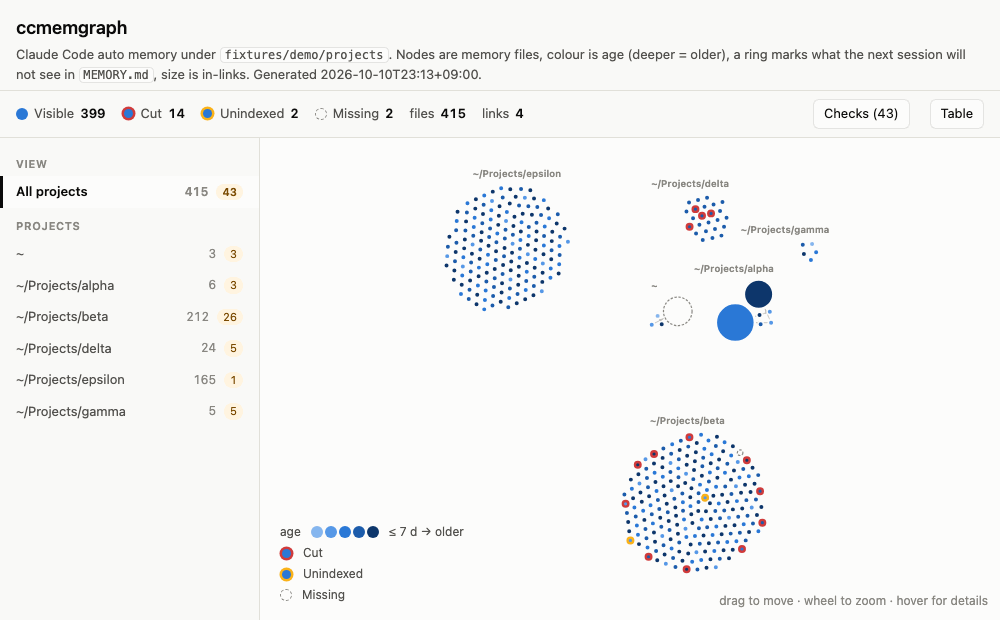

# ccmemgraph



**X-ray for Claude Code's auto memory: every project, what gets loaded, what's gone stale.**

```
claude plugin marketplace add MasaoSasaki/ccmemgraph
claude plugin install ccmemgraph@ccmemgraph
```

Then type `/ccmemgraph` in any session. Local only, nothing is sent anywhere, no dependencies beyond Python 3.9+ (the floor is the `python3` that ships with the macOS Command Line Tools, 3.9.6).

## What you see

Claude Code keeps auto memory per project under `~/.claude/projects/<project>/memory/`, with a `MEMORY.md` index. Only the first 200 lines (25,000 characters) of that index are loaded when a session starts, and the `/memory` command shows one project at a time. ccmemgraph reads every project at once and shows, for each memory file:

- **Visible** — listed inside the load window; the next session knows it exists.
- **Cut** — listed in `MEMORY.md`, but past the load window. The file is there; the session never hears of it.
- **Unindexed** — on disk, not in the index. Only memory recall can surface it.
- **Missing** — the index or a `[[link]]` points at a file that is gone.

Each node is one memory file. Colour is age (the deeper the blue, the longer since the `modified` stamp, or the file's mtime when there is none), a red or yellow ring marks the memories the next session will not see (cut or unindexed), a dashed circle is a missing file, and size is how many other memories link to it. Hover for the `type`, the index line and the description. The **Checks** panel lists the load window per project, with the exact lines Claude Code will cut, plus findings such as files longer than the 4,096 characters recall shows, memories outside the recall scan, broken `[[links]]`, duplicate files across projects, and memories that look like they were written into the wrong project's store. The **Table** panel is the same data sortable by age, size and links.

Everything is computed from the files as they are now, so it describes the *next* session, not the current one. Limits are those of Claude Code 2.1.296; the page says so, and says when the machine runs a different version. A weekly workflow re-reads the limits from the latest Claude Code release and opens an issue when they move.

## Running outside Claude Code

```
python3 skills/ccmemgraph/build.py            # scan ~/.claude/projects, write to the temp dir, open it
python3 skills/ccmemgraph/build.py --no-open --out ~/memory.html
python3 skills/ccmemgraph/build.py --root fixtures/demo/projects --fs-root fixtures/demo/fs --home /home/demo   # the demo data
```

The script reads your memory directories and writes one HTML file. It never writes under `~/.claude` and never opens a network connection; the D3 library is bundled into the page.

## Development

```
python3 -m unittest discover -s tests -v       # structure, load window, every finding kind on the demo data
cd tests/render && npm ci && npx playwright install chromium && node check.mjs out/demo.html   # layout and panel sync
python3 fixtures/generate_demo.py              # regenerate the demo data set
python3 tests/limits_probe.py                   # re-read the limits from the installed Claude Code binary and compare with build.py
```

## License

MIT. The bundled D3 (7.9.0) is ISC licensed; see `skills/ccmemgraph/vendor/LICENSE-d3`.
